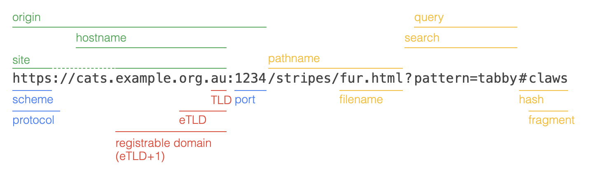

In my last project at Optimizely, we had just went through a reorg and I was assigned to the Digital Asset Management(DAM) team from the Content Marketing Platform(CMP) Team. DAM was a completely separate module that would become it's own product separate from CMP. Our first project was adding the Custom URL module to DAM.

As the feature name suggests, this feature would allow users to set custom url paths to their assets, which can be images, files, videos. It would be a way to make the URL more recognizable among some other benefits. We made a few more improvements along the way with the entire system which we'll discuss here.

So firstly to set some context, we initially used a subdomain to serve these assets like: `assets.opti.com/<asset-id>` with another variation for SEO friendly URLs `assets.opti.com/<file-name>-<asset-id>`. I can't exactly remember the url structure.

Secondly, we already allowed users to set their own domain to point to our infra by generating CDNs with SSL certificates attached to it. So a url like `assets.mycompany.com` could point to our servers and using the path URL described above one could access their assets.

A few learnings here were the limitations that the cloud provider had inherently. Theoretically, you could have a lot of custom domains attached to your server using only one SSL certificate but CloudFront only allowed 100 different domain names attached to 1 CDN which would be restrictive for us. Generating a brand new CDN for every domain was simpler to manage and reason about.

Most of our customers used their own domains but a subset used our domain for their assets. This brought about the unique challenge of scoping the asset's custom URLs. Meaning, customers that used their own domain could use a url like `mycompanyA.com/pengiun.jpg` and it wouldn't conflict with `companyB.com/pengiun.jpg`. But of course, there could only be one `assets.opti.com/pengiun.jpg`.

Now to coming to our solution, we had to make sure the original URLs always worked and one tradeoff we made that time was that once a custom URL was assigned to an asset it would be permanent and any edits would only create a new URL pointing to the same asset. This was done to ensure old URLs still worked(**backwards compatibility**).

The fact that this was a new codebase and team was a challenge to begin with. Coupled with the fact that this system has been evolving for the last 7-8 years with context scattered across documentation, code and of course people meant that getting things right would take some effort. More so since this was already handling huge traffic from our customer's own websites.

The first job was to gather context so that we don't break other systems and processes while building our own. This meant reading the docs, editing them to reflect the current reality and a lot of meetings with the people who are still at the company with this knowledge.

After a few iterations, the thing that we eventually stuck with came after reducing our scope to the bare minimum.
The functional requirements came out to be:

1. Old URLs must work normally as before. So we won't let users make URL paths that resembled our original paths in any way. We had to narrow down the invalid custom URL paths to a set of regex patterns.
2. We had to ensure that the system always had one unique URL, this meant only the origin and the pathname had to be unique across our system. Plus, we had to strip off things that did not fall into the identity of a resource like fragments and query params. As I'm writing, I just remembered that we used query params to apply transformations to the image so ignoring query params was essential anyways.

<!-- PORTFOLIO_PROOF: Add a screenshot or demo of the shipped Custom URL feature. -->

3. Images can be retrieved using that custom URL path. We can edit the path, and the previous paths should continue working to ensure that content that used those old paths don't show broken links.

Naturally, the non-functional requirements would be:

1. Fast image retrieval time.
2. Image path should be alive for clients very quickly.

Now, our existing system already had these setup with CDNs and Edge functions that ran on the CDNs. So, image retrieval was fast but we were adding another step to this workflow. Mapping custom URL paths to the original media. We made sure we were careful not to add too many operations to this flow since this path was very high volume and even a second of added latency meant \$\$\$ to our cloud bill.

Luckily for us, we were already using DynamoDB in our CDNs for checking view permissions for any particular asset and since DynamoDB is a globally distributed database it meant that reads could happen in the same edge location as our CDN, meaning we didn't have to account for any network latency you get when the data store is far away from the requesting server. DynamoDB has a few other desirable properties but mostly it is very fast to read and write, and can be tuned to get very consistent reads.

The second learning came when we were trying to test our system, and again it's mainly due to cloud provider quirks. So, CDNs are globally distributed, Lambdas on the other hand are not. However, Lambda@Edge which is a separate service are also technically globally distributed which is what we used to run logic alongside our CDN. CloudFront CDN logs used to show up in the same dashboard but Lambda@Edge logs only showed up if we set the AWS region to the region where the edge function was running on. Which was ap-south-1 in our case IIRC. That was few good hours of hair-pulling and the docs didn't help us a lot too.

I was talking about the custom domain CDNs previously. To make sure customers with a custom domain could create and retrieve assets scoped to their organization we needed a reliable way to get the domain that was requesting the asset. We settled with using a custom header that contained that hostname and forwarded that header from the custom domain CDN to the asset retrieval CDN. There might have been better ways to deal with this especially if we could have a single CDN configuration that could handle all the domains.

Finally, when we were able to get everything up and running. We realized we had 2 separate Lambdas running for 2 separate types of assets, files and media. After having worked on this part of the product for so long we quickly understood that all of this could be done in 1 lambda and a few more refactors could be done that would have real impact our cloud costs even though it wasn't measured at that time.

This was my first time working with infrastructure very closely and I worked with a lot of new tools like the AWS SDK, Terraform, and Ansible. Plus, learnt a ton from my colleagues who have had a wealth of experience working on this product for a long time.
